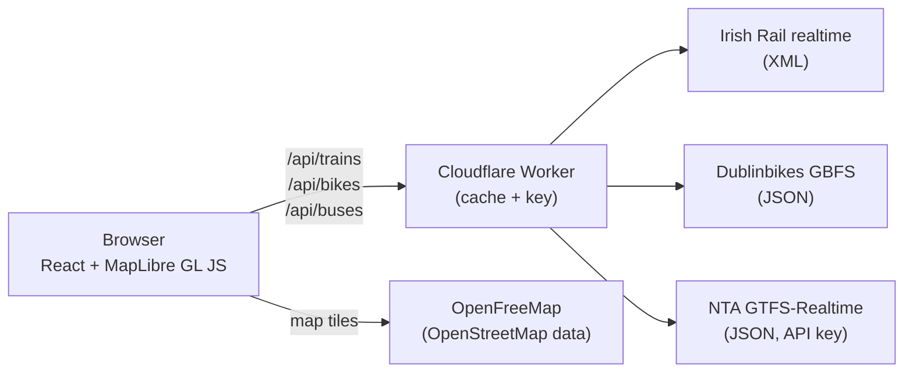

# Dublin Live

> The city, awake. A glowing 3D night map of Dublin where the trains, buses and bikes move in real time.


**Live demo:** [YOUR-SITE.pages.dev](https://YOUR-SITE.pages.dev) (replace with your deployed URL)

Dublin Live is an art-directed, real-time map of Dublin. It is deliberately not a journey planner and not a standard map. There are no labels or icons. Roads are glowing veins, buildings are dark glass in 3D, and everything that moves is a point of light: trains are golden comets, buses are lavender lanterns, and bike stations are twinkling fireflies. The sky, the colours and the moon follow the real position of the sun.

Open the link and the camera glides in from Dublin Bay to the city centre. Click any train or bus and the camera rides along with it.

<!--
Add screenshots or a short GIF to docs/ and uncomment.


-->

## What it does

- **Live trains.** Irish Rail trains appear as golden comets with fading tails. Click one to fly down to it, follow it across the city, and see its route and status.
- **Live buses.** Dublin Bus, Bus Éireann and Go-Ahead Ireland vehicles in the Dublin area appear as lavender lanterns. Click one to follow it and see its route number.
- **Dublinbikes fireflies.** Every station glows and twinkles. Colour and size show how many bikes are left (mint for plenty, blue for few, violet for none). Click a station for classic and electric bike counts and free docks.
- **Real day and night.** The colours of the whole city blend through night, twilight, sunrise, golden hour and daylight, calculated from the real sun position over Dublin. The moon phase is shown too.
- **Time slider.** Drag the clock up to 12 hours either way to preview dawn, dusk or midnight, then jump back to live.
- **Landmark beacons.** Ten glowing landmarks, from the Spire to the Poolbeg Chimneys. Hover for the name, click to fly there.
- **Cinematic camera.** An intro flight from the bay, a slow idle orbit until you touch the map, and a smooth follow camera.
- **Live status.** Counters for trains, buses and bikes, with friendly messages if a data feed is unavailable.

## How it works

The browser asks a small serverless API for live positions, and draws them with MapLibre.



**Why a Worker?** It keeps the NTA API key secret, turns Irish Rail's XML into small JSON, avoids browsers blocking plain-`http` sources, and caches each feed so many visitors share one upstream request. Trains are cached for 15 seconds, bikes for 30, and buses for 60 to respect the NTA's fair usage policy.

**Smooth movement.** Feeds update every so often, so each vehicle glides from its old position to the new one. What you see is therefore a little behind real life, and it says so rather than pretending to be exact.

**The look.** The map style is built entirely in code from OpenFreeMap's vector tiles. The palette is a set of keyframes keyed to the sun's height above the horizon, and the city repaints as the time changes.

## Tech stack

| Area | Technology |
|---|---|
| UI | React, Vite |
| Map and 3D | MapLibre GL JS (custom style, 3D building extrusions, sky and light) |
| Sun and moon | SunCalc |
| Map data | OpenFreeMap (OpenStreetMap, OpenMapTiles schema) |
| Live data | Irish Rail realtime API, Dublinbikes GBFS feed, NTA GTFS-Realtime v2 |
| API layer | Cloudflare Workers (free plan) |
| Hosting | Cloudflare Pages |

Everything used here is free or open source.

## Project structure

```
dublin-live/
├── public/
│   └── routes.json              Bus route numbers, generated from NTA timetable data
├── scripts/
│   └── make-routes.mjs          Builds routes.json from the NTA GTFS routes.txt
├── src/
│   ├── engine/
│   │   ├── config.js            Shared map area
│   │   ├── palette.js           City colours by sun height
│   │   ├── landmarks.js         Landmark beacons
│   │   ├── world.js             Map, style, sky, camera and wiring
│   │   ├── trains.js            Live trains, trails and follow mode
│   │   ├── buses.js             Live buses and follow mode
│   │   └── bikes.js             Dublinbikes fireflies
│   ├── App.jsx                  Interface: pills, cards, clock
│   ├── main.jsx
│   └── index.css
├── worker/
│   ├── src/index.js             API: /api/trains, /api/bikes, /api/buses
│   ├── wrangler.jsonc
│   └── package.json
├── index.html
├── package.json
└── .env.example
```

The `engine/` folder is plain JavaScript with no React, so the real-time map loop never causes React re-renders.

## Getting started

### Prerequisites

- Node.js 20 or newer
- A free NTA developer key for the bus feed. Sign up at [developer.nationaltransport.ie](https://developer.nationaltransport.ie), subscribe to the GTFS-Realtime API, and copy your primary key. Trains and bikes need no key.

### 1. Clone and install

```bash
git clone https://github.com/SCORLEOs773/dublin-live.git
cd dublin-live
npm install
cd worker
npm install
cd ..
```

### 2. Add your key (never commit it)

Create `worker/.dev.vars` containing:

```
NTA_API_KEY=your-key-here
```

Create `.env` in the project root containing:

```
VITE_API_URL=http://localhost:8787
```

Both files are git-ignored. `.env.example` shows the format for the second one.

### 3. Run it

Use two terminals.

```bash
# Terminal 1: the API
cd worker
npm run dev

# Terminal 2: the site
npm run dev
```

Open the address Vite prints (usually `http://localhost:5173`). The API serves `http://localhost:8787/api/trains`, `/api/bikes` and `/api/buses`. Restart the relevant server after editing `.env` or `.dev.vars`, because they are only read at startup.

### Bus route numbers (optional)

`public/routes.json` is already included. To regenerate it from the latest NTA timetable data:

```bash
curl -L -o gtfs.zip "https://www.transportforireland.ie/transitData/Data/GTFS_Realtime.zip"
# unzip it, then:
node scripts/make-routes.mjs path/to/gtfs/routes.txt
```

## API

All endpoints are `GET` and return JSON.

| Endpoint | Returns | Cached for |
|---|---|---|
| `/api/trains` | Running trains: code, position, direction, status message | 15 seconds |
| `/api/bikes` | Dublinbikes stations: position, capacity, bikes, electric bikes, free docks | 30 seconds |
| `/api/buses` | Buses in the Dublin area: trip, route, start time, position | 60 seconds |

If a feed fails, the Worker serves the last good answer when it has one, and an error otherwise. The site shows a friendly message.

## Deployment

**1. Deploy the Worker** (free Cloudflare account):

```bash
cd worker
npx wrangler login
npx wrangler secret put NTA_API_KEY   # paste your key when asked
npm run deploy
```

This prints a URL such as `https://dublin-live-api.YOUR-NAME.workers.dev`. Open `/api/trains`, `/api/bikes` and `/api/buses` on it to check each one.

**2. Deploy the site** on Cloudflare Pages, connected to this repository:

- Build command: `npm run build`
- Build output directory: `dist`
- Environment variable: `VITE_API_URL` set to your Worker URL, with no trailing slash
- If the build complains about the Node version, add `NODE_VERSION` = `22`

Vite bakes environment variables in at build time, so changing `VITE_API_URL` needs a redeploy. Remember to run `npm run deploy` in `worker/` whenever you change the Worker, because the site talks to the deployed copy.

The Worker's free plan has daily request and CPU limits. The site polls gently (trains every 20 seconds, bikes and buses every minute) and pauses when the tab is hidden. Check Cloudflare's current free-plan limits before relying on them.

## Troubleshooting

| Problem | Fix |
|---|---|
| A pill says a feed is unavailable | Check the Worker is running (locally) or deployed (online), and that `VITE_API_URL` matches it |
| The browser console says `"Dublin Live API" is not valid JSON` | The site is talking to an out-of-date deployed Worker. Run `npm run deploy` in `worker/` |
| Buses say unavailable | `worker/.dev.vars` is missing, misplaced or has a wrong key. Restart the Worker after fixing it |
| Few or no trains and buses | Services run during the day and evening, so late at night there are very few |
| Bus cards show a raw route code instead of a number | Regenerate `public/routes.json` from the latest timetable data |
| Blank dark screen | Hard-refresh. The map container needs the CSS in `index.css` |

## Data and attribution

- **Trains:** Iarnród Éireann (Irish Rail) realtime API, provided as-is. Positions are estimates from the signalling system, and coverage is weaker in some areas.
- **Buses:** National Transport Authority GTFS-Realtime, covering Dublin Bus, Bus Éireann and Go-Ahead Ireland. Subject to the NTA's fair usage policy.
- **Bikes:** Dublin City Council Dublinbikes open data (CC BY 4.0).
- **Map:** OpenFreeMap, using data from OpenStreetMap contributors. Attribution is shown on the map and must stay visible.
- **Sun and moon:** calculated with SunCalc.

Dublin Live is an independent project and is not affiliated with or endorsed by any of these organisations. It is not for navigation or travel planning. Vehicle positions are approximate and slightly delayed.

## Roadmap

- [x] Art-directed 3D night map with real day and night
- [x] Live trains with trails and a follow camera
- [x] Dublinbikes fireflies
- [x] Live buses with route numbers
- [ ] Rain, fog and weather that follow the real forecast
- [ ] Imagined Dubliners: simulated walkers you can follow
- [ ] Landmark discoveries and little challenges
- [ ] Luas trams
- [ ] Snap vehicles to routes for smoother movement
- [ ] Ambient sound and a photo mode
- [ ] Other cities

## License

MIT. See [LICENSE](LICENSE).

## Author

Built by Sukhad Sharma.

## Acknowledgements

[MapLibre GL JS](https://maplibre.org), [OpenFreeMap](https://openfreemap.org), [OpenStreetMap](https://www.openstreetmap.org) contributors, [SunCalc](https://github.com/mourner/suncalc), [Cloudflare Workers](https://workers.cloudflare.com), and the open data published by Irish Rail, the National Transport Authority and Dublin City Council.
